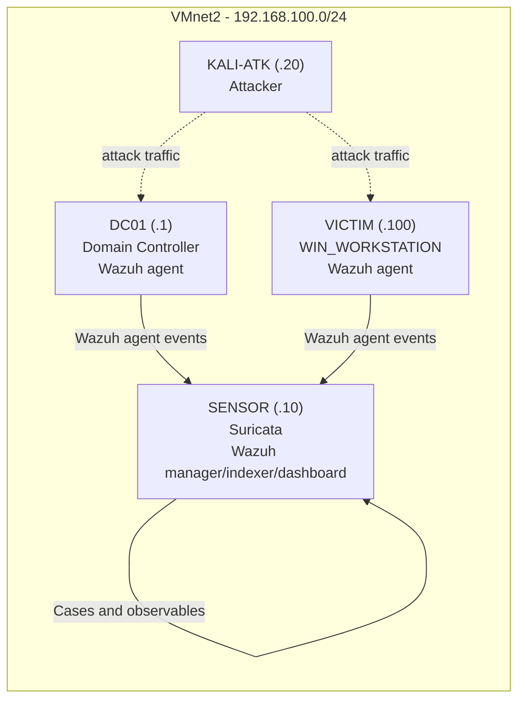

## Block 3 — Incident Response & Digital Forensics
Full NIST SP 800-61r2 Cycle Applied to the Block 1–2 Attack Chain
Lab: corpnet.local (isolated VMnet2, 192.168.100.0/24) Machines: DC01 (compromised host) · VICTIM (WIN_WORKSTATION, compromised host) · KALI-ATK (attacker) · SENSOR (Suricata + Wazuh manager + TheHive, via Docker) Objective: Take the Block 1 attack chain (Kerberoasting → AS-REP Roasting → DCSync → LSASS Credential dumping ) and the Block 2 detections, and Block 3 runs a complete Incident Response lifecycle against them — disk imaging, network/log forensics, case management, containment/eradication/recovery, and formal chain of custody.

Scope note: this lab has no physical Fortigate appliance. Fortigate traffic logs referenced below are simulated in the documented syslog format, generated from real pcap timestamps — this is explicitly disclosed rather than presented as genuine appliance output.


### 1. Architecture



### 2. Pre-Incident Preparation
#### 2.1 Forensic Workspace Setup (SENSOR)
```bash
# Dedicated, isolated evidence directory with restricted permissions

sudo mkdir -p /forensics/{disk_images,memory_dumps,pcaps,logs,evidence_log}

sudo chmod 700 /forensics

sudo chown $(whoami):$(whoami) -R /forensics
```
#### 2.2 Baseline Snapshot (Critical — Do This Before Any Attack Runs)
In VMware Workstation, snapshot DC01 and VICTIM in their clean state
```bash
vmrun snapshot "DC01.vmx" "clean-baseline"

vmrun snapshot "VICTIM.vmx" "clean-baseline"
```

#### 2.3 Tool Installation Checklist (SENSOR / KALI-ATK)

```bash
# Disk/memory forensics

sudo apt install dcfldd volatility3 -y

pip install volatility3 --break-system-packages
```
```bash
# Network forensics

sudo apt install zeek tshark -y
```
```bash
# Log parsing

pip install python-evtx --break-system-packages
```
*FTK Imager Lite: download separately (Windows-only), mount as VMware virtual CD/USB for DC01*


### 3. Phase 1 — DETECTION
(This phase reuses and extends Block 2's Suricata output, adding Wazuh host-based correlation.)
#### 3.1 Network Detection (Suricata, from Block 2)
Reuse rules sid:1000001 (Kerberoasting), 1000002 (AS-REP Roasting), 1000003 (DCSync) from block2-sensor-detection.md. Confirm they are still active:
```bash
sudo suricata -c /etc/suricata/suricata.yaml -i <interface>

tail -f /var/log/suricata/fast.log
```
#### 3.2 Network Detection (Wazuh)
```bash
sudo systemctl restart wazuh-manager
```
Confirm On wazuh Dashboard see the both Active Agents (DC01, WORKSTATION)

#### 3.3 Network detection (Zeek)
```bash
sudo mkdir -p /forensics/CASE-2026-001/working/zeek
cd /forensics/CASE-2026-001/working/zeek

sudo zeek -C -i ens33
```
logs to analyze:

```text
conn.log
kerberos.log
notice.log        ← if created
weird.log         ← for suspicious activity
```
